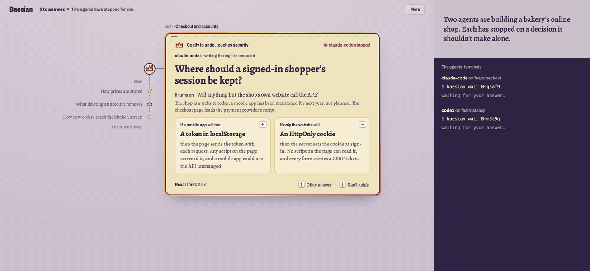
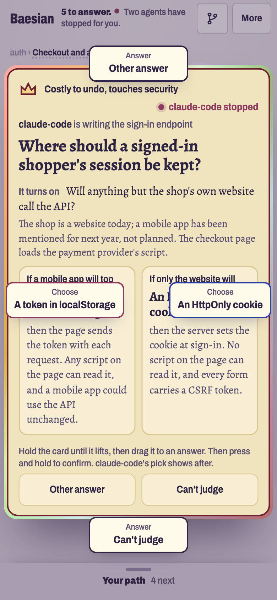
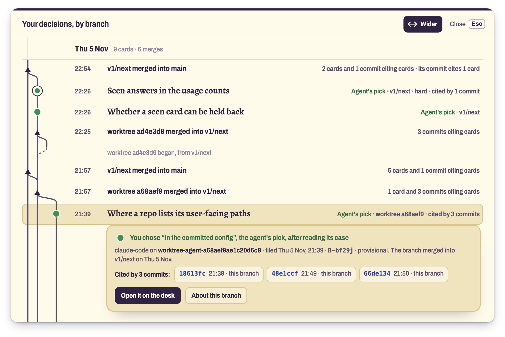
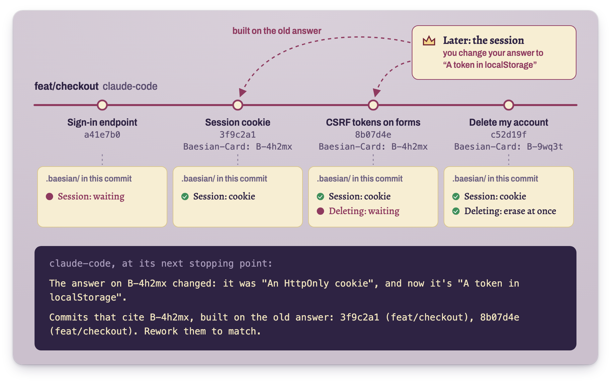

<p align="center">
  <picture>
    <source media="(prefers-color-scheme: dark)" srcset="docs/media/wordmark-dark.png">
    
  </picture>
</p>

<p align="center"><b>Swipe review for the decisions your coding agents shouldn't make alone.</b><br>
They put each one to you as a card, and you choose before you see their pick.</p>

<p align="center">
  <a href="https://baesian.dev">baesian.dev</a> ·
  <a href="#try-the-demo">Try the demo</a> ·
  <a href="#how-it-works">How it works</a> ·
  <a href="#set-it-up">Set it up</a> ·
  <a href="docs/setup.md">Setup guide</a>
</p>

<p align="center">
  
  
</p>
<p align="center"><sub>At your desk, two agents building a made-up bakery's shop stop for you: you choose, see their pick,
overrule one, and each agent's terminal gets your answer. On your phone, you hold a card until it lifts and drag it to
an answer.</sub></p>

> [!NOTE]
> Baesian is in development, and not released yet. The hosted client at [baesian.dev](https://baesian.dev) runs
> v0.1.8; the CLI and the plugin install from this repo; file formats may change before v1.

Your Claude Code and Codex agents make design decisions all day, and a few of them are hard to undo: where a
signed-in user's session lives, how prices are stored, what deleting an account removes. Baesian has the agent put
those to you as cards, before it builds on them. You pick one of its two options before you see which it chose, then
confirm or overrule it. Your answer goes back to the agent, and into git with the code it shapes.

## Try the demo

You need Node 22 or later, and git.

```sh
git clone https://github.com/GusEllerm/baesian.git
cd baesian
npm install
npm run demo
```

The demo makes a throwaway repo where two agents are building Crumb, a made-up bakery's online shop, and have filed
five decisions. It opens the client, and its terminal shows what each agent gets as you answer.

## How it works

1. **An agent files a card** when a decision is hard to undo or isn't its call alone: a schema, a public API, a
   dependency, CI, security, anything user-facing. `baesian init` tells your agents when, in `AGENTS.md`.
2. **You choose first,** between its two options, then see which it picked and why, and confirm or switch.
3. **The agent waits as long as the decision needs:** on most cards it carries on and gets your answer at its next
   pause; on a *blocking* card it waits for you; on a *hard* card, the default for security, privacy, data loss, money
   and publishing, it never goes ahead without you, and you hold to confirm.
4. **Your answer goes back to the agent,** and into git, committed with the code it shapes.

Two things keep decisions from slipping past: a **commit gate** blocks a commit that adds a dependency, changes a
schema or touches CI until a card covers it or the agent says why it's safe; and the **plugin** sends an agent that
asks you to choose in chat back to file a card.

## Why choose before you see the pick?

Seeing the agent's case first anchors you: a confident argument is easy to agree with. Choosing first records, for
each kind of decision, how often you'd have picked what the agent picked. That record is how Baesian suggests which
kinds you could leave to the agent. When you keep answering one kind the same way, Baesian offers to make it a rule
your agents follow without asking.

## Decisions live in git

Each branch carries its own cards, committed with its code, so decisions merge with the code they shaped. The client's
**Your decisions, by branch** (press B) draws that history: where each branch began, what was decided on it, and every
merge with what it brought.

<p align="center"></p>
<p align="center"><sub>Baesian's own decisions on one evening: worktrees branching off v1/next, the cards filed on them
and the commits citing those cards, merging back.</sub></p>

Every commit names the cards it builds on, so if you change an answer later, the agent is told which commits built on
the old one. In CI, `baesian verify` checks each commit's decisions, and holds a merge until its cards are answered.

<p align="center"></p>
<p align="center"><sub>Each commit carries the decisions as they stood. When an answer changes, the commits that built on
the old one are named.</sub></p>

## Set it up

You need Node 22 or later, git, and Claude Code or Codex. The [setup guide](docs/setup.md) has each step in full.

### 1. Install the CLI

Baesian isn't on npm yet, so build it from this repo:

```sh
git clone https://github.com/GusEllerm/baesian.git
cd baesian
npm install
npm run build && npm link
```

### 2. Make an account

Sign up at [baesian.dev](https://baesian.dev) and make a passkey. Add one on each device you answer from, your phone
included.

### 3. Set up your repo

```sh
cd your-repo
baesian init
baesian login
```

`init` sets up the commit gate and tells your agents about Baesian. `login` links the repo to baesian.dev: approve
this machine on the page it prints, then run the commit it prints.

### 4. Install the plugin

In Claude Code:

```text
/plugin marketplace add /path/to/baesian
/plugin install baesian@baesian
```

<details>
<summary><b>Claude Code in VS Code, and Codex</b></summary>

In the VS Code extension, run the same from a terminal, then start a new conversation:

```sh
claude plugin marketplace add /path/to/baesian
claude plugin install baesian@baesian
```

In Codex:

```sh
codex plugin marketplace add /path/to/baesian
codex plugin add baesian@baesian
```

Codex runs the plugin's hooks only after you accept its "Hooks need review" prompt in interactive mode, and again after
any update.
</details>

<details>
<summary><b>Checking decisions in CI</b></summary>

```sh
baesian ci --github
```

sets the repository variable CI reads its keys from; then add the workflow steps it prints. See
[the setup guide](docs/setup.md#5-check-decisions-in-ci).
</details>

<details>
<summary><b>Without an account, or in a repo you share</b></summary>

`baesian init` then `baesian serve` gives you the client on your own machine, with nothing sent anywhere; `baesian
login` links the repo later. In a repo whose other contributors don't use Baesian, `baesian init --personal` keeps
everything in your clone and commits nothing. Both are in [the setup guide](docs/setup.md#without-an-account).
</details>

## Development

```sh
npm test               # unit tests
npm run e2e            # browser tests, with Playwright
npm run typecheck
npm run readme-media   # remakes this README's images (needs ffmpeg)
```

The project's memory is the Obsidian vault in [`docs/vault/`](docs/vault/Home.md): the design, the decision log, and
a log of each working session. Start at `Home.md`.

## Why "Baesian"

It's a dating app for decisions. Your agents line up their options, you swipe on the one you'd pick before you see
which one they picked, and over time you build up preferences for each kind of decision. The decisions you keep
agreeing on become rules, so your agents can make them for you from then on.
